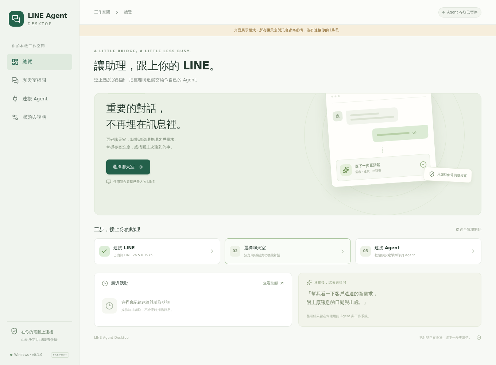

# LINE Agent Desktop

**選好聊天室，讓你原本的 AI 助理能查 LINE。**

Windows 本機桌面工具。使用已登入的 LINE 電腦版，勾選允許讀取的聊天室，
再把 MCP 連線設定帶到 Codex、Claude Desktop 或其他支援本機 MCP 的 Agent。



[下載 Windows 測試版](https://github.com/wsxqaza12/line-agent-desktop/releases) ·
[使用方式](#開始使用) · [開發與打包](#開發與打包) · [驗證紀錄](docs/VALIDATION.md)

這是 **0.1.0 Preview**。已在 Windows 11 x64、LINE 26.5.0.3975 上實測。
安裝包內附 Node、Python 與讀取器依賴，不需要另外安裝開發環境。
需要你自己的 Agent；這個工具沒有內建模型或 AI 訂閱。

## 開始使用

1. 從 Releases 下載 `.exe` 安裝包並安裝，或下載 `.zip` 解壓到固定位置。
2. 開啟電腦版 LINE，使用你原本已登入的帳號。
3. 開啟 **LINE Agent Desktop**，按「檢查 LINE 連線」。
4. 到「聊天室權限」載入或搜尋聊天室，勾選後按「儲存聊天室權限」。
5. 按「開啟 Agent 存取」。預設為暫停，不會自動授權任何聊天室。
6. 到「連接 Agent」複製設定。Codex 可選 Windows 或 WSL；Claude Desktop 使用 JSON 設定。
7. 在 Agent 重新載入 MCP，試著問：「列出我已授權的 LINE 聊天室。」

設定要加入既有檔案，保留原本的其他伺服器；不要整份覆蓋。重複安裝時更新同名區塊。
MCP 測試按鈕會核對本機工具的握手與清單；Agent 是否已載入，仍要在該 Agent 裡確認。
WSL 設定使用 `/mnt/<磁碟>/` 與 Windows 程式互通，使用自訂掛載路徑時需自行調整 command。

測試版尚未使用程式碼簽章，Windows 可能顯示未知發行者。請確認下載來源與 Release 的 SHA-256。

## 可以做什麼

- 確認 LINE 執行狀態與相容版本。
- 搜尋最近 30 天的本機聊天室名稱，逐個授權。
- 明確按下「讀取測試」後，查看日期範圍內的一頁訊息與來源引用。
- 產生 Windows／WSL Codex 與通用 MCP 設定。
- 暫停全部存取，或取消單一聊天室授權。
- 查看最近的連線、讀取與權限變更結果。

接上後可以對 Agent 說：

> 整理「聊天室名稱」最近七天的新需求與待回覆事項，附上原訊息時間與出處。

> 根據這段對話，幫我草擬一段回覆，先給我確認。

需求紀錄、提醒、GitHub issue 與長期記憶，由 Agent 寫入你指定的工作系統。
此版本提供唯讀文字與附件中繼資料，不會傳送 LINE 訊息，不會自行建立 issue，
也沒有定時掃描或開機自動啟動。

## 怎麼運作

```text
桌面介面 ── 選擇聊天室 / 儲存權限 / 查看狀態
                     │
你的 Agent ── 本機 stdio MCP ── 權限檢查 ── 上游 LINE 本機讀取器
                     │                         │
              每次重新讀取授權             已登入的 LINE 電腦版
```

MCP 只提供三個工具：

| 工具                 | 用途                                |
| -------------------- | ----------------------------------- |
| `get_line_status`    | LINE 相容性、執行狀態、存取是否開啟 |
| `list_allowed_chats` | 列出使用者已選取的聊天室            |
| `read_line_messages` | 依聊天室參照與日期讀取一頁訊息      |

每次讀取綁定聊天室與登入帳號的參照。讀取前後都重新檢查授權，
中途暫停或變更權限時會捨棄結果。Agent 無法透過工具修改授權。
同一個 MCP 工作階段一次只執行一個讀取工作。

關閉桌面視窗不會取消已儲存的授權。Agent 可以自行啟動 MCP；
要停止訊息存取，請先按「暫停所有存取」。不使用 Agent 時沒有常駐讀取服務。

## 資料與限制

- 設定位於 `%APPDATA%\LINE Agent Desktop\settings.json`，含所選聊天室名稱與身分參照。
- `activity/` 保存最近 200 筆操作中繼資料，介面顯示最近 30 筆，不記錄聊天原文。
- 此工具不另外保存訊息內容；上游讀取器會產生受限的加密資料庫暫存快照並在結束時清除。
- 交給 Agent 的訊息會依該客戶端與模型服務的設定處理，不能把「本機讀取」當成「模型離線執行」。
- 本機快取不等於完整伺服器歷史。每次最多查 31 天、500 筆，可用同一範圍的 cursor 分頁；日期採 Asia/Taipei。
- 聊天室名稱必須能由本機索引確認。有些在 LINE 介面中存在的對話可能未列出，這版沒有 GUI 備援讀取。
- 未驗證的 LINE 版本會停止讀取，不能略過版本或 DLL 核對。
- 聊天內容是待整理的資料，不是 Agent 應服從的指令。
- 權限限制適用於本工具的 MCP。它不限制同一個使用者帳號下的其他程式。

遇到問題，請附上錯誤代碼、Windows / LINE 版本與可重現步驟。
不要上傳真實訊息、設定檔、資料庫或帳號資料。

## 開發與打包

開發需要 Node.js 24 LTS；準備發行用執行環境時還需要 Python 3。

```bash
npm ci --ignore-scripts
npm test
npm run build
```

瀏覽器展示使用合成資料，並有明確的展示標示：

```bash
npm run dev
# 開啟 http://127.0.0.1:5179/?demo
```

UI 自動測試：

```bash
npx playwright install chromium
npm run test:ui
```

Windows 打包（PowerShell）：

```powershell
py scripts/prepare-runtime.py
npm run package:win
py scripts/finalize-release.py
```

`prepare-runtime.py` 下載 `runtime-lock.json` 指定的官方檔案、核對 SHA-256，
只寫入專案的 `.downloads/` 與 `runtime/`。不修改 PATH、全域 Python、排程或 Agent 設定。
如果 `runtime/` 已存在，先把它移到其他位置；腳本不會覆寫現有目錄。

輸出包含 NSIS 安裝包、ZIP 與 `release/win-unpacked/`。完整發行流程與檢查見
[發行指南](docs/RELEASING.md)。

## 開源來源與授權

LINE 讀取能力來自 [bensonmaxai/line-desktop-mcp](https://github.com/bensonmaxai/line-desktop-mcp)，
其源自 [dtwang/line-desktop-mcp](https://github.com/dtwang/line-desktop-mcp)。
本專案新增桌面介面、聊天室權限管理、連線設定、診斷與可攜執行環境的包裝。

專案程式採 MIT；各依賴保留原授權與署名，見 [THIRD_PARTY_NOTICES.md](THIRD_PARTY_NOTICES.md)。
這是社群工具，與 LINE 官方無關。
